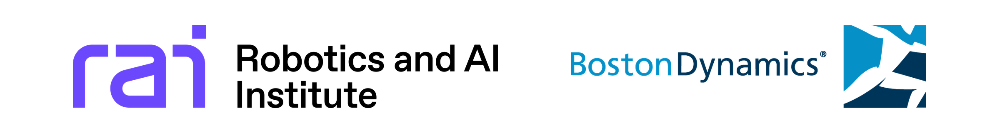

HOLD is a dataset contains a collection of human motion data collected at [RAI Institute](https://rai-inst.com/) in collaboration with [Boston Dynamics](https://bostondynamics.com/) using a [Vicon](https://www.vicon.com/) optical motion capture system. 

## What is included? 

In total, HOLD includes 4,053,854 data samples across 552 human motion trajectories (276 originals and their mirrored counterparts), corresponding to 576.6 minutes of data (Recording rate 120 Hz). The data includes: 
- Wide-ranging human locomotion on flat terrain, from small-step shuffling, standard walking, sidestepping, and turning to high-speed jogging and sprinting, across various headings and speeds to cover a wide range of body planar velocities.
- Whole-body human-object interactions, such as lifting, carrying, and pushing boxes as well as climbing boxes, sitting on chair etc.

The data is provided in BVH format under [`data/bvh`](data/bvh/). We post-processed the raw motion capture recordings to remove kinematic artifacts caused by sensor noise and tracking errors that occasionally occur in optical motion capture systems.

For convenience, we also provide 80%-scaled data that matches the dimensions of widely used commercial humanoid robots such as the Unitree G1. This reduces the artifacts that the dimension gap would otherwise introduce during motion retargeting to these robots.
As an example of retargeting results, we provide motion data retargeted to the Unitree G1 robot under [`data/g1`](data/g1/).    

For a comprehensive preview of the dataset, see [docs/preview.md](docs/preview.md).

## How was the data collected and processed?

The whole-body human-object interaction recordings focused on diversity of behaviors, while the flat-terrain locomotion recordings focused on covering a wide range of planar body velocities, with transitions between speeds and gait modalities. For locomotion in particular, we collected data iteratively: whenever the locomotion policies we developed with HOLD showed capability gaps caused by data sparsity, we collected additional examples. For instance, if sidestepping performance was sub-optimal, we recorded more sidestepping data.

Every BVH file in HOLD was post-processed to remove kinematic artifacts. Because of sensor noise and tracking errors that occasionally occur in optical motion capture systems, foot bones can exhibit slight misalignments, which makes the timing of ground-contact events ambiguous. To address this, we estimate the ground plane and the corresponding sole positions from the kinematic configuration and the foot height relative to the coordinate origin, during periods when the actor is determined to be stationary.

See [docs/process.md](docs/process.md) to learn more about the post-processing. We also invite readers to the [HuMBLE: Human Motion-Driven Behavior Learning for Embodied Locomotion](https://arxiv.org/abs/2610.10489) paper for more details on how we collect, process, and utilize the HOLD dataset.

## Halo loco-manipulation subset

Sources: RAI Halo Loco_Manipulation 10_27_2025 (20 takes) and 11_20_2025 (35 takes), converted to hold's BVH convention by the `cast` pipeline (`cast.datasets.converters.halo_to_convention`).

Behavior-categorized under [`data/bvh/halo_loco_manipulation/<category>/`](data/bvh/halo_loco_manipulation/). Only the original frame rate is provided (no 80%-scale variant in this subset). Each original ships with a `_mirrored.bvh` companion generated by the same L/R-swap + axis-mirror convention used elsewhere in the dataset.

Props (parented to `Z_UP_WORLD_ORIGIN` with 8 corner end-sites per hold's prop-bone convention): `Box`, `BoxSmall`, `BoxLarge`, `StepBox`, `Chair`. Sole bones are estimated per-take with the velocity + height stance heuristic described in [docs/process.md](docs/process.md).

### Categories

| Category | Originals | Mirrors | Description |
|----------|-----------|---------|-------------|
| `pick` | 33 | 33 | Box pick from various human poses, box heights, box orientations, and shelf height. |
| `place` | 5 | 5 | Place a held box at varying drop heights. |
| `carry` | 5 | 5 | Walk while carrying a box (including step-up-and-place takes). |
| `tumble` | 5 | 5 | Whole-body manipulation of large boxes: tumble, push-tumble, tumble-then-carry, and chair multicontact. |
| `door` | 7 | 7 | Door traversal while holding a small or large box. |
| **total** | **55** | **55** | |

See [docs/halo_loco_manipulation.md](docs/halo_loco_manipulation.md) for the full file index.

## Getting started 

We distribute this data using [`git-lfs`](https://git-lfs.com/). To install git lfs (Debian/Ubuntu):
```bash
sudo apt-get install git-lfs
git lfs install
```
Install it before cloning so the large files are downloaded. If you already cloned the repository, run `git lfs pull` to fetch them. For other platforms, see the [git-lfs installation guide](https://git-lfs.com/).

Then download the dataset by cloning this repository:
```bash
git clone https://github.com/rai-opensource/hold.git
```

We recommend using [Blender](https://www.blender.org/) to visually inspect the BVH animations. A Blender plugin for visualizing the G1-retargeted trajectories is currently under development.

## Research using HOLD

HOLD was used in RAI-BD collaboration work [HuMBLE: Human Motion-Driven Behavior Learning for Embodied Locomotion](https://arxiv.org/abs/2610.10489), which develops fully steerable human-like locomotion in humanoid robots. 
Notably, the human-like steerable locomotion was showcased for the Boston Dynamics, new Atlas robot launching event at CES 2026 live on stage to the public. 

We open-source HOLD data to foster broad progress in humanoid research under the license of [Creative Commons Attribution 4.0 International license](LICENSE).

If you use this work in your research or project, please consider citing it using the following BibTeX entry:

```
@misc{raibd2026hold,
  author = {RAI Insitute, Boston Dynamics},
  title = {HOLD: Humanoid Omniskill Loco-manipulation Dataset},
  month = {October},
  year = {2026},
  url = {https://github.com/rai-opensource/hold}
}
```

## Acknowledgments

HOLD is the result of a collaboration between the RAI Institute and Boston Dynamics. We thank all the contributors who were involved in the collection, processing, and release of this data. We especially thank Jonathan Foster for serving as our human performer.



If you have any questions about the dataset, please contact [Dongho Kang](mailto:dkang@rai-inst.com).

